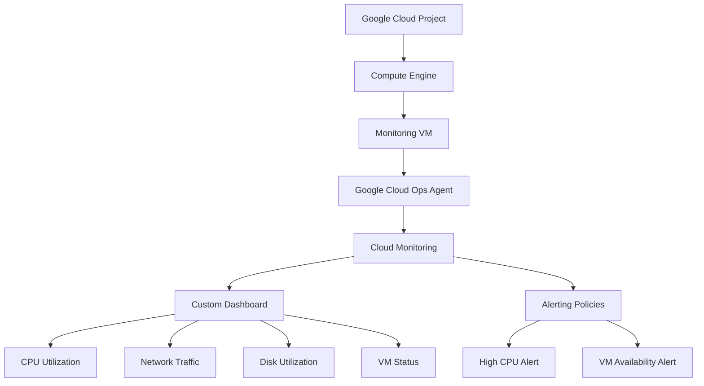

# Google Cloud Monitoring Dashboard & Alerting

A cloud infrastructure monitoring project built using **Google Cloud Platform (GCP)** to observe virtual machine performance, visualize system metrics, and configure alerting policies.

[](https://cloud.google.com/)
[](https://cloud.google.com/monitoring)
[](https://cloud.google.com/compute)

## 📌 Project Overview

This project demonstrates how to monitor a Google Compute Engine virtual machine using Cloud Monitoring. It includes a custom monitoring dashboard for visualizing performance metrics and alerting policies for identifying potential infrastructure issues.

The project also explores the Google Cloud Ops Agent for collecting guest operating system metrics and troubleshooting metric collection and export problems.

## 🎯 Objectives

- Monitor virtual machine CPU utilization and network traffic.
- Visualize infrastructure metrics using a custom dashboard.
- Collect guest operating system metrics using the Ops Agent.
- Configure alerting policies for potential performance and availability issues.
- Investigate missing metrics and monitoring data export errors.

## 🏗️ Architecture



## 🛠️ Technologies Used

| Technology | Purpose |
|---|---|
| Google Cloud Platform | Cloud infrastructure |
| Compute Engine | Virtual machine hosting |
| Cloud Monitoring | Metrics visualization and monitoring |
| Ops Agent | Guest OS metrics and log collection |
| Monitoring Dashboards | Performance visualization |
| Alerting Policies | Condition-based notifications |
| Debian Linux | Virtual machine operating system |
| Git & GitHub | Version control and project documentation |

## 📊 Monitoring Metrics

### 1. CPU Utilization
Monitors the proportion of allocated CPU capacity being used by the virtual machine.

**Metric:** `compute.googleapis.com/instance/cpu/utilization`

### 2. Network Traffic
Tracks network bytes received by the virtual machine to help observe network activity.

**Metric:** `compute.googleapis.com/instance/network/received_bytes_count`

### 3. Disk Utilization
Uses the Ops Agent to collect guest disk usage information and identify storage capacity concerns.

**Metric:** `agent.googleapis.com/disk/percent_used`

**Note:** Disk metric collection requires successful agent metric export and a matching monitored resource and time range. This metric was under troubleshooting during project development.

### 4. VM Status
Provides visibility into the virtual machine's operational status using the available Compute Engine and Cloud Monitoring data.

## 🚨 Alerting Policies

### High CPU Utilization Alert
- **Purpose:** Identify sustained high CPU usage.
- **Metric:** CPU utilization.
- **Threshold:** 80%.
- **Action:** Configure an appropriate notification channel, such as email.

### VM Availability Alert
- **Purpose:** Identify potential VM availability or uptime issues.
- **Approach:** Use an appropriate VM state or uptime metric and configure the alert condition according to the selected metric.

*Alert behavior depends on the final policy configuration and notification channel.*

## 📸 Screenshots

Add screenshots from your own Google Cloud Console to document the implementation.

Suggested repository structure:

```text
cloud-monitoring-dashboard/
├── README.md
└── screenshots/
    ├── monitoring-dashboard.png
    ├── cpu-utilization.png
    ├── network-traffic.png
    ├── disk-utilization.png
    └── alerting-policies.png
```

After uploading your screenshots, display them here by adding the corresponding Markdown:

```markdown


```

Only add screenshots after uploading the matching image files to the repository.

## 🔍 Challenges and Troubleshooting

During development, the project involved troubleshooting:

- Missing disk utilization time series.
- Ops Agent metric export failures.
- Cloud Monitoring billing restrictions.
- Metric filters, monitored resource types, and time-range selection.

These issues demonstrate the importance of validating cloud billing status, metric collection, permissions, and monitoring configuration.

## 📚 Key Learnings

- Provisioning and managing virtual machines in Google Cloud.
- Building custom infrastructure monitoring dashboards.
- Understanding built-in Compute Engine metrics and guest OS metrics.
- Configuring threshold-based alerting policies.
- Troubleshooting metric collection and export failures.
- Documenting cloud infrastructure projects using GitHub.

## 👩‍💻 Author

**Joyce Vinuthna Namburi**

B.Tech — Computer Science and Engineering

- **GitHub:** [@namburijoyce](https://github.com/namburijoyce)
- **Project Repository:** [cloud-monitoring-dashboard](https://github.com/namburijoyce/cloud-monitoring-dashboard)

---

*This project was developed for hands-on learning in cloud monitoring, infrastructure observability, and alerting using Google Cloud Platform.*
